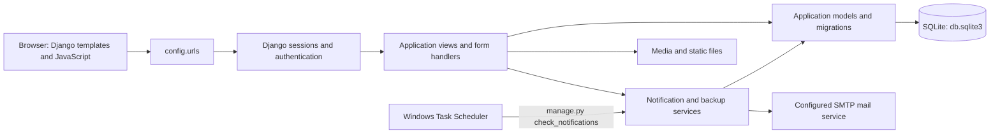

# GBMS — Gas Business Management System

GBMS is a Django application for recording gas-cylinder sales and returns, customer and supplier balances, product stock, purchases, payments, cylinder movements, FBR-oriented reports, operating expenses, and reminders. Its normal interface is a browser-based, server-rendered application; a number of forms use JavaScript and private JSON endpoints for in-page updates.

> **Before publishing this workspace:** local `.env`, SQLite database, backups, media, and logs can contain credentials and private business data. They are excluded by `.gitignore`; verify the staged files before every push. See [Development, configuration, and operations](docs/development-and-operations.md#public-repository-and-production-readiness).

**Project owner:** [Muhammad Wasim](https://github.com/muhammadwasim92logics)

## What the application does

| Area | Implemented capabilities |
|---|---|
| Customers | Customer records, walk-in customers, opening/bring-forward (B.F.) balances, customer profiles, account ledgers, customer status, and print views |
| Deliveries and payments | Daily and individual delivery entry, returns, delivery charges, damage charges, low-pressure pricing details, delivery-linked and standalone payments, and transaction history |
| Products and stock | Product catalog, sellable/purchasable flags, full and empty-cylinder stock, stock reports, opening stock balances, and factory-fill movements |
| Cylinders | Customer cylinder balances, ownership movements, cylinder dashboard, and ledger |
| Suppliers and purchases | Supplier records, purchases, supplier payments, product and supplier ledgers, tax and gas-specific purchase calculations |
| FBR reporting | FBR-oriented invoice and ledger reports, customer tax-number settings, product-category mapping, and delivery invoice-number assignment |
| Earnings | Paid delivery income, paid supplier purchases, expenses, opening cash balance, partner bank-account snapshots, and daily summaries |
| Notifications and backups | Inactivity, low-stock, overdue-payment, cylinder-due, weekly, and backup reminders; on-demand backup download and email |
| Accounts and administration | Django username/password authentication, public signup, logout, and Django admin |

These are application features, not a claim that the system integrates with or submits data to an external tax authority.

## Architecture at a glance



The diagram reflects the configured default, not a production deployment topology. The complete module and data-flow description is in [Architecture and code map](docs/architecture.md).

## Repository map

```text
.
├── apps/
│   ├── accounts/       # Login, signup, logout
│   ├── customers/      # Customer records, balances, ledger, walk-in command
│   ├── cylinders/      # Cylinder ledger and dashboard
│   ├── dashboard/      # Business overview
│   ├── deliveries/     # Sales, daily entry, returns, payment synchronization
│   ├── earnings/       # Cash summaries, expenses, opening/partner balances
│   ├── fbr/            # FBR reports, invoice numbering, mappings
│   ├── notifications/  # Rules, settings, backup service, scheduled command
│   ├── payments/       # Standalone customer payments
│   ├── products/       # Catalog, stock, factory filling
│   └── suppliers/      # Suppliers, purchases, supplier ledgers
├── config/             # Django settings, root URL configuration, WSGI/ASGI
├── templates/          # Shared layouts and app-specific HTML templates
├── static/             # CSS, JavaScript, and application icons
├── media/              # Runtime-uploaded media directory
├── backups/            # Runtime backup destination; do not publish
├── manage.py           # Django management entry point
├── requirements.txt    # Python dependencies
├── run.ps1             # Windows starter without scheduled-task registration
├── start_gbms.ps1      # Windows starter with hourly notification task setup
├── start_gbms.bat      # Windows launcher for start_gbms.ps1
└── run_notification_checks.ps1
```

Each app owns its models, views, URL patterns, and—where present—forms, tests, management commands, template tags, and migrations. See [the full code map](docs/architecture.md#codebase-map) and [the data model](docs/data-model.md).

## Quick start (Windows PowerShell)

Use a Python installation compatible with Django 4.2. Run these commands from the project root:

```powershell
py -m venv .venv
.\.venv\Scripts\Activate.ps1
python -m pip install --upgrade pip
python -m pip install -r requirements.txt
python manage.py migrate
python manage.py check
python manage.py runserver 127.0.0.1:8000
```

Open <http://127.0.0.1:8000/>. The root redirects to the dashboard, which requires authentication. The signup page is `/auth/signup/`; a newly created account can sign in at `/auth/login/`.

The database configured by default is the project-root `db.sqlite3`. `migrate` creates or updates the schema; it does not populate a production catalog or business data. Settings are loaded from process environment variables and, when present, a root `.env` file. See [`.env.example`](.env.example) and [setup, configuration, and operating procedures](docs/development-and-operations.md) before using any seed command or existing data.

## Documentation

- [Architecture and code map](docs/architecture.md) — request handling, application boundaries, integrations, and source layout.
- [Features and workflows](docs/features-and-workflows.md) — business behavior, inventory/accounting flows, notifications, and backup flow.
- [Data model](docs/data-model.md) — entities, relationships, key fields, and deletion behavior.
- [Routes and internal JSON endpoints](docs/api-reference.md) — the URL surface and the JavaScript-facing endpoints.
- [Development and operations](docs/development-and-operations.md) — installation, settings, commands, tests, Windows launchers, deployment caveats, and troubleshooting.

Existing focused FBR notes are available in [FBR improvements summary](FBR_IMPROVEMENTS_SUMMARY.md) and [FBR improvements detail](FBR_IMPROVEMENTS_DETAILED.md).

## Technology

- Python and Django 4.2.x (bounded by `Django>=4.2,<5`).
- SQLite is the configured database. A PostgreSQL driver is listed as a dependency, but PostgreSQL is not selected in the checked-in settings.
- Django templates, Bootstrap-based layouts, custom CSS/JavaScript, and JSON responses from Django views.
- Pakistan Standard Time (`Asia/Karachi`) is the configured time zone.
- SMTP is used by the backup-email workflow.

The full dependency/configuration notes and limitations are in [Development and operations](docs/development-and-operations.md).

## Important scope and deployment notes

- The FBR area builds application reports and manages invoice identifiers. No outbound FBR submission client is present in the inspected code.
- The JSON routes are page-support endpoints, not a versioned public REST API or a documented third-party integration contract.
- The checked-in settings are local-development settings. They are not a production deployment recipe.
- No Docker configuration or deployment pipeline is included in the project files inspected.
- Do not deploy Django's development server to the public internet. Production requires a separately configured server, secrets, database, HTTPS, static/media handling, and an operational backup plan.
- See the publication warning above and the detailed [public repository checklist](docs/development-and-operations.md#public-repository-and-production-readiness) before pushing this workspace to GitHub.
