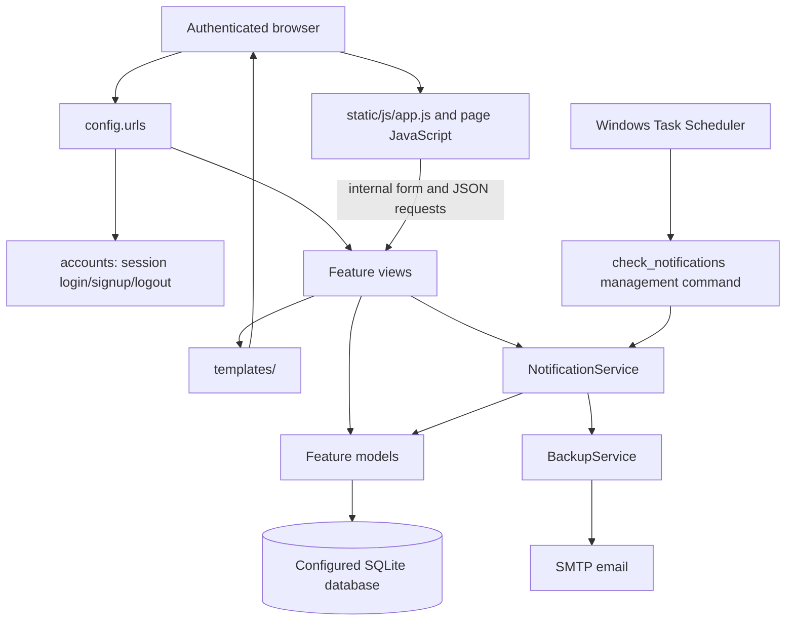
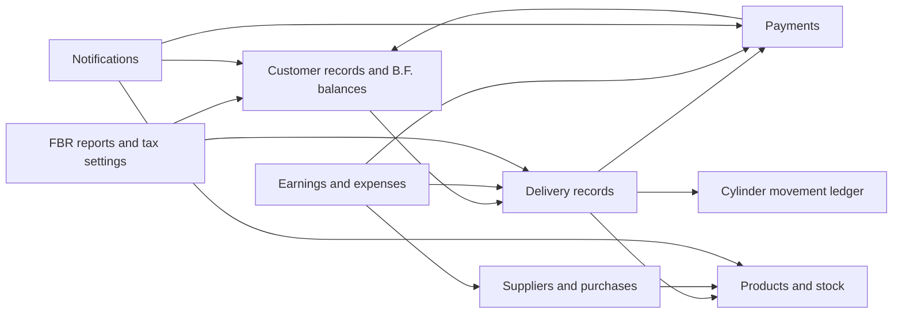

# Architecture and code map

## System shape

GBMS is a single Django project composed of feature-oriented Django apps. Django's URL dispatcher selects a view; most screens render a template, while interactive forms also call Django views that return JSON. Models and view/service code share one configured relational database. There is no separate frontend build, API server, task-queue service, or external FBR client in the inspected project.

### Request and data flow

1. `config.urls` routes the request to an app URL module.
2. Django middleware provides sessions, authentication, messages, CSRF processing, security headers, and common request handling.
3. A view loads or validates model/form data, performs related accounting or stock updates, and returns a template, redirect, or JSON response.
4. Templates inherit from `templates/base.html` or `templates/base_auth.html`. Browser JavaScript handles selected dynamic forms and calls internal JSON routes.
5. Models persist business records. Database changes are versioned in per-app Django migrations.
6. Notification checks can be run manually, through the management command, or by the Windows scheduled task created by one of the launchers.

Some multi-record operations use `transaction.atomic()` to keep related writes together. Inspect the owning view before relying on transaction or rollback behavior for any specific workflow.

## Runtime configuration

`manage.py` selects `config.settings`. The project-root settings configure:

- Django built-in admin, auth, sessions, content types, messages, and static-file apps.
- Project apps for accounts, dashboard, customers, products, deliveries, payments, cylinders, notifications, FBR, suppliers, and earnings.
- Django templates from the root `templates` directory and app template folders.
- SQLite at `BASE_DIR / "db.sqlite3"`.
- `Asia/Karachi`, timezone-aware date/time handling, root `static/`, `staticfiles/` as `STATIC_ROOT`, and root `media/`.
- Session login redirects, a long-lived session, email SMTP settings, and Crispy Forms with Bootstrap 5.

The precise settings, limitations, and safe override guidance are in [Development and operations](development-and-operations.md#configuration-reference).

`config.wsgi` and `config.asgi` are standard Django entry points. Their existence does not mean a production web server or deployment profile is supplied.

## Codebase map

### Project-level files

| Path | Purpose |
|---|---|
| [`manage.py`](../manage.py) | Django command-line entry point; sets `config.settings` |
| [`config/settings.py`](../config/settings.py) | Installed apps, middleware, templates, database, locale, static/media, auth, session, and mail configuration |
| [`config/urls.py`](../config/urls.py) | Root route prefixes, admin route, root redirect, and debug-mode static/media serving |
| [`config/wsgi.py`](../config/wsgi.py), [`config/asgi.py`](../config/asgi.py) | WSGI and ASGI application objects |
| [`requirements.txt`](../requirements.txt) | Python dependency constraints |
| [`templates/`](../templates/) | Shared layouts and app-specific pages |
| [`static/`](../static/) | First-party CSS, JavaScript, icons, and favicon assets |
| `media/` | Runtime media directory configured as `MEDIA_ROOT`; contents may be private |
| `backups/` | Created/used by the backup service; backup archives may contain the database and media |
| `logs/`, `output.txt` | Local operational artifacts, not application source |
| `screenshots/`, `Business_Application_Report.html` | Supplemental local project artifacts |

The workspace also contains `FBR_IMPROVEMENTS_SUMMARY.md` and `FBR_IMPROVEMENTS_DETAILED.md`; those are focused supporting notes, not a substitute for this source-based documentation.

### Django apps

| App | Main responsibility and important code |
|---|---|
| `apps.accounts` | Custom login, built-in `UserCreationForm` signup, logout, and a CSRF/session regression test. |
| `apps.dashboard` | Authenticated overview of customers, deliveries, payments, stock alerts, customer-status counts, recent records, and a 14-day sales chart. |
| `apps.customers` | Customer identity, B.F. financial/cylinder balances, customer ledger/profile, printing, walk-in identity reuse, template filters, and `create_walkin_customer` command. |
| `apps.products` | Product catalog, stock reports, stock opening balances, factory records, factory-fill transactions, stock JSON lookups, forms, and `add_products` command. |
| `apps.deliveries` | Delivery model/form, daily-entry workflow, inventory changes, cylinder ledger synchronization, linked payment synchronization, delivery APIs, and display filters. |
| `apps.payments` | Standalone customer payment list/recording and payment form. Payments can also be linked to deliveries. |
| `apps.cylinders` | Cylinder dashboard and customer ownership/movement ledger. |
| `apps.notifications` | Notification/settings models, threshold checks, backup generation/email, notification views, form, tests, and `check_notifications` command. |
| `apps.fbr` | FBR-oriented reports, invoice-number allocation, customer tax settings, product mappings, admin registration, filters, and a delivery pre-save signal. |
| `apps.suppliers` | Supplier/purchase models, category-specific purchase computations, purchase APIs, ledgers, and admin registration. |
| `apps.earnings` | Cash-flow-style totals from collected delivery payments, supplier payments, expenses, opening balance, daily summaries, and partner account snapshots. |

Each app's `urls.py` is included under its root prefix in `config/urls.py`. Apps with migrations keep schema history in `apps/<app>/migrations/`; the app-local `tests.py` files exercise workflows and calculations. `forms.py`, `admin.py`, `templatetags/`, and `management/commands/` exist only in the apps that need them.

### Templates and static assets

- `templates/base.html` is the authenticated application shell and shared navigation/layout. It loads first-party `static/css/style.css` and `static/js/app.js`.
- `templates/base_auth.html` is the login/signup shell and loads `static/css/auth.css`.
- `templates/<app>/` contains feature pages; `templates/customers/print.html`, profile/ledger print styles, and other print-aware pages use the browser print flow.
- `static/img/` contains favicon and desktop shortcut icon assets.
- Shared templates load Bootstrap 5, Font Awesome, Choices.js, Google Fonts, and (in the authenticated shell) Chart.js from external CDNs. Browser access to those CDNs is therefore part of the current UI behavior.

## Cross-app responsibilities

- Deliveries are the main sales record. Delivery views also reconcile their associated `Payment` and `CylinderLedger` rows and adjust product stock.
- Standalone payments are stored in the same `Payment` table as delivery-linked receipts and refunds.
- Supplier purchases reference products and suppliers. Purchase-entry views update product stock and maintain supplier running balances.
- Dashboard, earnings, notifications, and FBR reports read records owned by other apps rather than owning separate copies of the underlying sales ledger.
- `Customer.bf_balance`, `Customer.previous_balance`, and `Customer.bf_cylinders` are opening/bring-forward values used alongside later delivery, payment, and cylinder movement records.

Relationship details and deletion rules are in [Data model](data-model.md).

## Integrations and boundaries

### Present

- **Django authentication/session framework:** standard Django users and session-backed login.
- **SMTP:** used by the backup-email feature through Django's mail API. The actual configured account and credential must be treated as secret and rotated if exposed.
- **External browser CDNs:** Bootstrap, Font Awesome, Choices.js, Google Fonts, and Chart.js are referenced by shared templates.
- **Windows Task Scheduler:** the Windows starter can register an hourly call to the notification management command.
- **Local filesystem:** SQLite database, media, static files, and backup archives.

### Not implemented/configured as a working integration

- The `fbr` app produces local reports and manages numbers/settings; no network client submits an invoice to an FBR service.
- JSON responses are ordinary Django view responses; no versioned/public REST API, API-token flow, or DRF view/router set was found.
- `requirements.txt` includes Django REST Framework, `django-cors-headers`, `python-dotenv`, `django-allauth`, `openpyxl`, `reportlab`, `psycopg2-binary`, and WhiteNoise. The inspected project does not configure all of these as active features: for example, `.env` loading, a PostgreSQL database backend, WhiteNoise middleware, allauth routes, and DRF API views are not set up in the current settings/URL code.

## Important implementation characteristics

- There is no custom user model. Feature views generally require a signed-in user, but authorization is not uniformly applied to every lookup route; see [route/auth notes](api-reference.md#authentication-and-csrf).
- Several JSON write routes explicitly use `csrf_exempt`. The user session requirement and CSRF protection are separate controls.
- The default development server is bound to `127.0.0.1` by the documented starter commands. `DEBUG`, hosts, CSRF, secure cookies, secrets, and static/media handling must be reviewed before any public deployment.
- The checked workspace is not a Git repository. This documentation does not create, commit, or push a GitHub repository.
