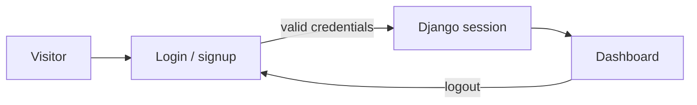
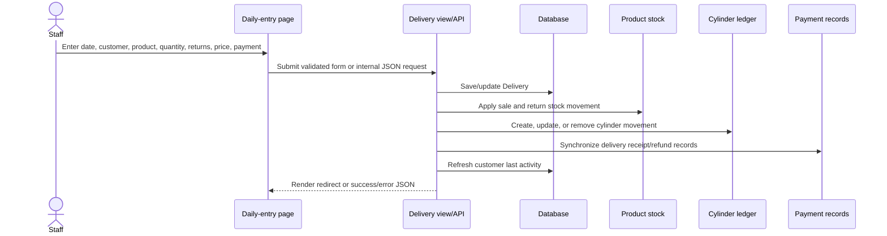
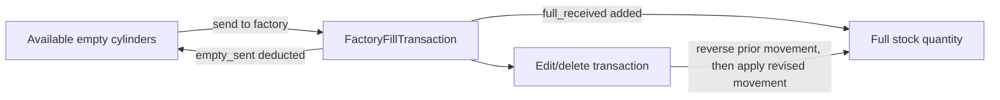
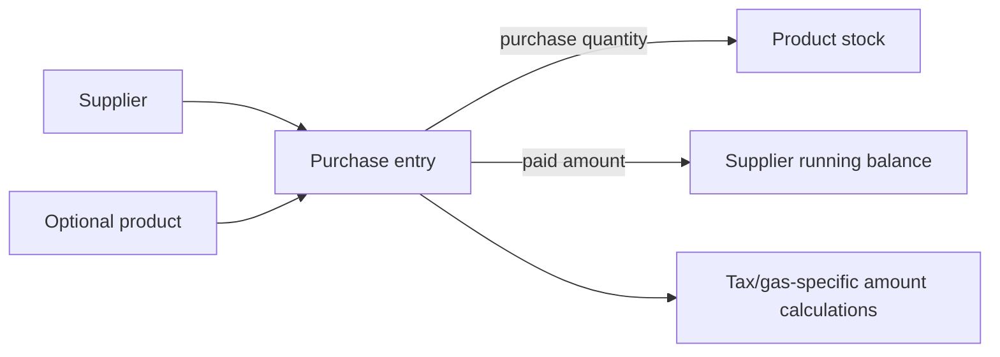

# Features and workflows

This document describes behavior visible in the models, views, services, management commands, and templates. The source code is authoritative where an edge case is not explained here.

## Sign-in and user accounts



- `/auth/login/` uses Django's `LoginView` with a custom template and welcome/error messages.
- `/auth/signup/` uses Django's built-in `UserCreationForm`; it redirects new users to login.
- `/auth/logout/` uses Django's `LogoutView`.
- There is no custom user model or application role system. Most feature views require login, but route access is not uniform; consult the [route and authentication reference](api-reference.md#authentication-and-csrf).

## Dashboard

The authenticated dashboard combines data from customers, deliveries, payments, products, and notification settings. It displays:

- Customer counts divided into active, inactive, and not-coming groups.
- Today's delivery count and billed value, weekly/monthly billed values, total order count, and an aggregate pending amount.
- Up to ten products at or below their minimum stock.
- Recent deliveries and payments.
- A 14-day daily sales chart and cylinder-product delivery/return aggregates.

The dashboard's inactivity thresholds come from notification settings. Customer model status helper methods also exist; do not assume every screen derives status in exactly the same way.

## Customer and account workflows

Customer pages support listing/filtering, creation/editing, profile and ledger views, printing, and deletion. The list includes date/status filtering and print-range controls. Customer ledger/profile data combines:

1. B.F. balance and product-specific B.F. cylinder counts.
2. Delivery charges and return records.
3. Linked and standalone customer payments.
4. Cylinder ownership movements.

The model's overall outstanding balance is computed as:

```text
sum(delivery_amount) - sum(customer payment amounts)
+ bf_balance + previous_balance
```

The B.F. customer setup workflow can save opening customer/account/cylinder details, including multiple customers in supported bulk setup scenarios. Customer pages also display editable contact/tax identifiers, security deposits, personal cylinders, and activity.

Walk-in customers can be reused by the daily-entry workflow so repeated sales do not necessarily create a new walk-in identity each time. The separate `create_walkin_customer` management command creates a default record when required.

## Daily delivery, inventory, and payment workflow



The delivery workflow is the primary bridge between the commercial, inventory, cylinder, and payment records:

- The daily-entry page handles date-based records and can create a customer during entry. Related views support editing, deleting, clearing, and payment-only entries.
- Delivery rows store quantity, price, calculated amount, returns, invoice fields, optional receipt amount/type, charges, damage details, and low-pressure pricing detail.
- `Delivery.save()` derives `has_returns` and calculates billed value from product charge, delivery/damage charges, and full-return credit.
- Delivery view helpers calculate the net full-stock movement as `full_returned - quantity`, then apply it to product stock; LPG/CO2-like product names can convert package quantity to kilograms using a weight parsed from the product name. Empty stock changes by the empty-return count for ordinary cylinder products, while quantity-only and filling-only products do not use the normal empty-cylinder exchange path. Stock weight is adjusted from the net movement and the product's unit weight.
- Cylinder-ledger rows capture customer-specific full/empty and ownership movements where applicable.
- Delivery payment synchronization creates/updates/removes related positive receipts and, when a full-cylinder return was paid in cash, a negative payment entry. A short-window duplicate check is used by the safe-payment helper.
- Customer last activity is refreshed by payment and delivery workflows.
- The individual delivery form and date-based daily-entry pages share the same underlying `Delivery` model but are separate user flows.

The model's billed-amount calculation uses the full-rate quantity plus each stored low-pressure `calculated_price` when low-pressure details are present; otherwise it uses quantity times unit price. Delivery charges and damage charges are then added, and the full-return value is subtracted.

The daily-entry JSON endpoint expects the structure used by its page JavaScript; it is not a separately versioned API. See [the endpoint inventory](api-reference.md#deliveries-and-payments).

### Customer balance before a selected date

The customer balance lookup used by the daily-entry UI sums delivery amounts and payment amounts strictly before the requested date, then adds B.F. and previous balances. Cylinder balance helpers similarly build a product breakdown from B.F. quantities, deliveries/returns, and ownership ledger entries.

## Product stock and factory-fill workflow

Products can be designated sellable, purchasable, quantity-only, or filling-only. Product settings include prices, minimum stock, full/empty stock, weights, and opening quantities.

The product screens provide catalog editing, stock overview and detail reports, category opening-stock balances, and a factory-fill workflow:



- Recording a factory fill checks that enough empty stock exists, saves the transaction, decreases empty stock, and increases full stock within an atomic transaction.
- Editing reconciles the previous movement against the new one and refuses changes that would subtract full cylinders already used or would result in a negative empty stock.
- Deletion reverses the recorded empty/full stock movements.
- Product and factory references are protected from deletion while fill transactions reference them.

Stock reports draw on product balances plus recorded deliveries, purchases, and other inventory movements. Report categories and conversions are implemented in `apps/products/views.py`; consult that code before changing a product naming convention or report arithmetic.

## Supplier and purchase workflow

Supplier pages support supplier CRUD, purchase entry, supplier history, product/supplier ledger views, and purchase update/deletion. A purchase can be product-based or payment-only:



- Product purchases calculate subtotal, applicable tax, and total in `Purchase.save()`.
- The purchase-entry view updates product stock and handles grouped purchase rows.
- Supplier-only payments can be recorded without a product or invoice.
- Edit/delete operations reconcile linked grouped purchase entries and stock changes; inspect the supplier views before adapting those operations.
- Supplier ledgers combine opening balance, purchase totals, and payments to show running balances.

Gas-specific calculations are selected by product-name matching for oxygen, nitrogen, CO2, argon/mixtures, and LPG. The current implementation is rule-based, not a configurable product taxonomy. See the [data model](data-model.md#suppliers-and-purchases--appssuppliers) and `apps/suppliers/models.py`.

## Payments and cash tracking

The Payments pages list and record standalone customer payments. Payment records may also be linked to a delivery. Payment creation records the current user, updates customer activity, and can return to the selected customer's profile.

The Earnings page presents a separate cash-flow-style summary:

```text
net cash = latest opening balance on or before end date
         + paid delivery amounts in selected date range
         - paid supplier purchase amounts in selected date range
         - expenses in selected date range
```

The API also returns partner bank-account snapshots separately. The current net-cash expression does not add those snapshots. Expenses can be added individually or in bulk; the bulk route validates rows before persisting them. Opening-balance records and daily summaries are also maintained.

## FBR-oriented reports and invoice numbers

The FBR screens build reports from delivery data. Product names are classified into CO2, LPG, oxygen-liquid categories, or excluded service/equipment categories through `apps/fbr/invoice_numbers.py`. Report views calculate displayed quantities, tax-exclusive values, GST, rates, totals, deductions, and customer tax identifiers from delivery and customer data.

The system supports:

- FBR ledger and invoice-report pages with customer/date selection.
- Customer STN/NTN settings and row-level invoice-number overrides.
- A delivery pre-save signal that allocates/reuses FBR invoice numbers for same-customer/date/category groups.
- A report action to reset or sequentially assign numbers for selected displayed groups, with conflict checks.
- Printing through the browser's print behavior.

**Boundary:** this is local report generation and number management. The inspected FBR code does not call an external FBR endpoint, submit tax invoices, or provide an external API integration. The FBR invoice models exist in the schema/admin, but the report views primarily construct rows from deliveries.

`apps/fbr/assign_invoice_numbers.py` is a management command for filling missing numbers; it is distinct from the normal pre-save signal. Review its source and data before running it on a live database.

## Notifications and scheduled checks

The notification service evaluates customer and stock data and creates in-app notifications:

| Rule | Current behavior |
|---|---|
| Inactive customer | Skips walk-in customers; checks the configured inactivity hours; includes balance/cylinder context; avoids a second notification of the same type/customer on the same day, whether the existing one is read or unread. |
| Low stock | Checks `stock_quantity <= minimum_stock`; same-day notifications are not recreated after being read. |
| Pending payment | Uses outstanding customer balance, configured minimum and age; oldest unpaid date is estimated by consuming payment totals against opening balances and deliveries. |
| Cylinders due | Uses net cylinder balance, configured minimum count, and age of the oldest outstanding cylinder. |
| Weekly summary | Runs on Mondays when enabled; summarizes up to ten customers with positive pending amounts or cylinders. |
| Backup reminder | Creates a reminder when no recent successful backup notification exists within the configured interval and no unread reminder is already present. |

Thresholds are stored in the singleton `NotificationSettings` record and edited through the notification settings page. The settings form represents durations as days and hours and converts them to stored hours.

The model defaults are: pending payment after 168 hours with a minimum amount of PKR 1,000; cylinder due after 0 hours with a minimum of 10 cylinders; inactive customer after 168 hours; not-coming after 720 hours; backup reminder after 24 hours; and weekly reminder enabled. Pending-payment eligibility uses an amount **greater than** its configured minimum and an age **at least** the configured delay. Notification settings can be changed in the UI, so these defaults are not necessarily the live values.

`python manage.py check_notifications` runs the checks. `start_gbms.ps1` also registers a Windows Task Scheduler task that runs `run_notification_checks.ps1` hourly. `run.ps1` starts the app but does not register that scheduled task.

## Backup workflow

The backup service builds an in-memory ZIP containing the configured SQLite database (if present), files under `media/`, and metadata.

- **Email backup:** `BackupService.send_daily_backup()` sends the archive using configured Django SMTP settings and creates a `BACKUP_SENT` notification only after the email backend confirms one message. It prevents another email backup after a successful same-day backup. Failed preparation or email delivery returns an error result and does not claim success.
- **Local download:** the notifications page can stream a ZIP attachment to the browser. The service does not first save that download into `backups/`; `backups/` is returned by a helper for backup storage, but the currently inspected backup payload/download flow is in-memory.
- **Reminder:** notification checks use the configured interval since the last successful backup notice.

The archive contains sensitive business data. Restrict its storage and delivery, protect the destination email, and never commit the archive to a public repository.
